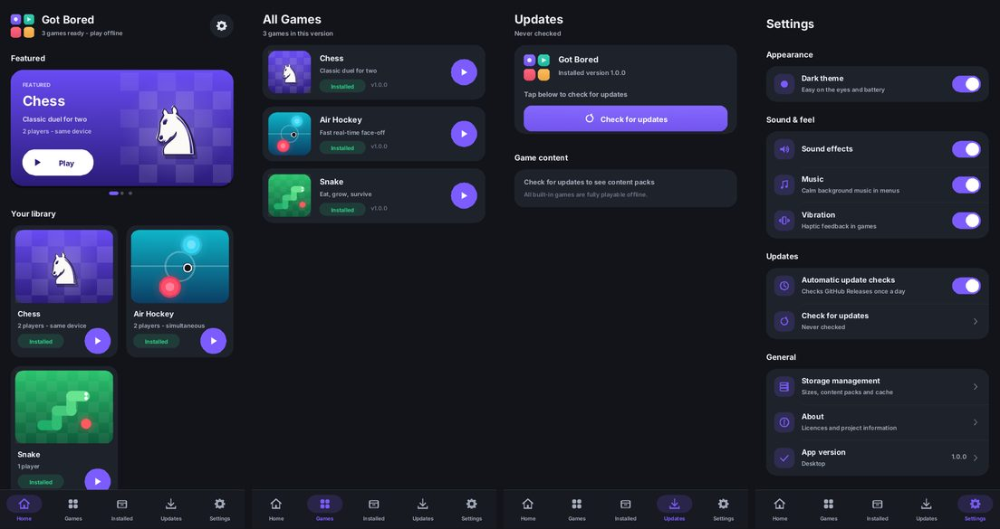
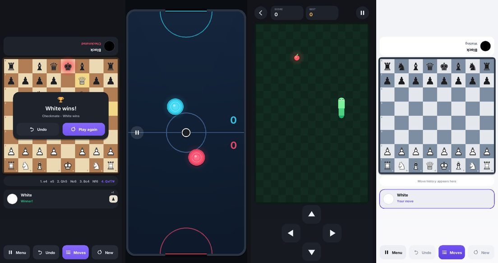

# Got Bored

A lightweight Android game collection ("N games in 1") written in **C++20 + SDL3 + CMake**.
It ships three fully playable games (**Chess** for two players, real-time **Air Hockey** for
two players, and **Snake**) and has an in-app update system backed by **GitHub Releases**.

* **APK size: ~2.0 MB** (arm64-v8a). There are no audio files and almost no images: the UI is vector-drawn and all sounds are synthesised at runtime. The only bundled assets are two subset fonts (32 KB) and the chess piece artwork (two PNGs, 31 KB; the board pieces are loaded only while chess is open).
* Almost all logic is C++. Java is limited to SDL's glue plus one bridge class for HTTPS, the system package installer and vibration.
* It is portable: shared code only talks to small platform interfaces, and there is already a desktop (Linux/macOS) implementation used for automated testing.




---

## Contents

| Path | What |
|---|---|
| `src/core` | App loop, settings, JSON, file utils, shared `AppContext` |
| `src/ui` | Vector renderer (AA shapes, stb_truetype text), immediate-mode UI, theme, icons, hub screens |
| `src/games` | `Game` interface + registry, `chess/`, `air_hockey/`, `snake/` (pure rule/physics code is separate from rendering) |
| `src/updates` | SHA-256, manifest validation, safe zip extraction, update state machine |
| `src/storage` | Content-pack index, sizes, uninstall, cache cleanup |
| `src/audio` | Procedural synth (`IAudio`) |
| `src/platform` | `Platform.hpp` interfaces; `android/` (JNI) and `desktop/` implementations |
| `android/` | Manifest, vector icon, `HubActivity` + `PlatformBridge` (Java), Gradle project + wrapper |
| `assets/fonts`, `assets/pieces` | Subset Inter fonts (UI) and the chess piece artwork |
| `packs/` | Optional downloadable content packs (data only) |
| `tests/` | Unit tests (chess perft, physics, snake, SHA-256, JSON, manifest, extraction, updater) and UI scripts |
| `scripts/` | `build_apk.sh`, `fetch_deps.sh`, `make_release.py`, `run_ui_tests.sh`, `check_jni.py` |
| `assets-src/` | Source artwork (chess piece SVGs) used to generate `assets/`, not shipped |

## Games

**Chess (2 players, one device).** Implements the full standard rules:
* legal move generation with pins and checks;
* check, checkmate and stalemate;
* castling, with the rule against passing through check;
* en passant;
* promotion to any piece, using a picker;
* threefold repetition, the fifty-move rule and insufficient material.

The engine is verified with standard *perft* node counts on five reference positions. The UI has:
* tap-to-move and drag-and-drop;
* highlighted legal moves, last move, selected square and a check glow;
* captured pieces with a material count;
* move history in standard notation;
* undo, restart and pause.

White plays from the bottom. Black's panel and the promotion picker are rotated to face the player opposite.

The two automatic draws (threefold repetition and fifty-move) are applied immediately rather than waiting for a player to claim them. This suits casual play.

**Air Hockey (2 players simultaneously).** Uses true multi-touch: each finger is assigned to the player whose half it first touches. Physics are fixed-step at 240 Hz, with:
* friction, restitution and speed limits;
* paddle velocity transferred to the puck;
* goal posts, and protection against the puck getting pinned against a wall.

Matches are first to 7. There is a start screen, a 3-2-1 countdown, goal animations with screen shake, a win screen, pause, restart, and haptics.

**Snake (1 player).** Controlled by swiping or an on-screen D-pad, with buffered turns and smooth interpolated movement. Speed increases as you score, the high score is saved, and there are pause, restart and game-over screens.

## Modular games, downloads and Android rules

Android and Google Play policy do **not** allow loading downloaded native code, and doing so would be a security risk. The design therefore works like this:

* **Game code is compiled into the APK.** Each game is a C++ module of a few KB that implements `mgh::Game` and is registered in `src/games/GameRegistry.cpp` (id, name, version, description, procedural artwork, factory). Adding a game means adding a folder plus one registry entry.
* **New games arrive through app updates.** Because the code is so small, this keeps the APK tiny.
* **Per-game downloadable content packs are data only.** Examples are themes, sounds and levels. Each pack is listed in the release manifest with its version, size and SHA-256. The app downloads, verifies, extracts, updates and uninstalls packs individually. The sample packs are a marble chess board, a neon air hockey rink and a desert snake theme.
* **Downloaded files are never executed.** The extractor rejects path traversal, absolute paths, backslashes, symlinks, hidden files, encrypted entries, oversized or zip-bomb archives and non-data file types such as `.so`, `.dex` and `.apk`.
* **Release manifests can list games that need a newer app.** The Games tab shows these as "Available with the next update".

The three built-in games work fully offline. Their code cannot be uninstalled individually: it is part of the APK and is only a few KB. Content packs and per-game save data can be removed.

## In-app updates (GitHub Releases)

1. The app fetches `https://github.com/GL-328/Random-School-Games/releases/latest/download/manifest.json`. It does this automatically at most once a day (this can be turned off in Settings) and whenever you tap **Check for updates**.
2. The manifest is validated strictly before anything else happens:
   * schema version;
   * HTTPS URLs on GitHub hosts only;
   * 64-character SHA-256 values and size limits;
   * a `versionCode` consistent with the version;
   * game ids restricted to `[a-z0-9_]`.
3. Downloads show progress and can be cancelled. Every redirect hop must be HTTPS, and sizes are capped. Each file is checked against its expected size and SHA-256, and the APK is checked again just before installation.
4. The APK is then verified with `PackageManager`: the package name must match, the version must be newer, and it must be signed with the same certificate as the installed app.
5. Installation uses the Android **PackageInstaller** API, and **Android always asks the user to confirm**. On Android 8+ the user must first allow *Install unknown apps* for Got Bored. The app explains this and opens the right settings page; it never tries to bypass it.

### Release signing (important)

Android only installs an update if it is signed with the **same key** as the installed app. This is handled as follows:

* The workflow `.github/workflows/multigamehub-release.yml` signs releases with a key stored in repository secrets:

  | Secret | Contents |
  |---|---|
  | `MGH_KEYSTORE_BASE64` | your release keystore, base64-encoded |
  | `MGH_KEYSTORE_PASSWORD` | keystore password |
  | `MGH_KEY_ALIAS` | key alias |
  | `MGH_KEY_PASSWORD` | key password |

* To publish a release, bump `VERSION`, commit, then tag `vX.Y.Z` and push the tag. CI tests, builds and signs the APK, zips the packs, writes and validates `manifest.json`, and creates the GitHub Release.
* Install the app from the [GitHub Releases page](https://github.com/GL-328/Random-School-Games/releases). Those APKs are signed with the release key, so in-app updates work between them. Builds signed with any other key (for example local `build_apk.sh` builds without the secrets) cannot update a release build.
* Keep the keystore safe and never commit it (`*.jks` and `*.keystore` are git-ignored). If you lose it, existing installs cannot be updated.
* Google Play restricts the `REQUEST_INSTALL_PACKAGES` permission. The self-update feature is meant for GitHub distribution; a Play Store build would remove it and rely on Play updates.

Generate a key once:

```bash
keytool -genkeypair -keystore release.jks -alias multigamehub -keyalg RSA -keysize 4096 -validity 10000
```

Encode it for the GitHub secret:

```bash
base64 -w0 release.jks
```

Paste the output into `MGH_KEYSTORE_BASE64`.

## Building

You need CMake 3.22+, Ninja, a C++20 compiler, JDK 17+, and the Android SDK with platform 35, build-tools 35+ and NDK r29.

Fetch SDL3. It is pinned to release-3.4.18 and verified by commit hash.

```bash
./scripts/fetch_deps.sh
```

Build the signed APK. It is written to `build/android/`.

```bash
ANDROID_HOME=~/Android/Sdk ./scripts/build_apk.sh
```

Alternatively, use Gradle or open `android/` in Android Studio:

```bash
cd android && ./gradlew assembleRelease
```

Run the unit tests:

```bash
cmake -S . -B build/tests -G Ninja -DMGH_BUILD_APP=OFF
```

```bash
cmake --build build/tests && ./build/tests/mgh_tests
```

Run the headless end-to-end UI test. It drives the real app with scripted touches and saves screenshots.

```bash
./scripts/run_ui_tests.sh
```

Run the desktop development build (needs X11 or Wayland dev packages):

```bash
cmake -S . -B build/desktop -G Ninja && cmake --build build/desktop && ./build/desktop/multigamehub
```

## Performance and size notes

* **No idle rendering.** The hub only renders when something changes: it sleeps in `SDL_WaitEventTimeout` while idle. Games run at vsync, and rendering stops completely in the background.
* **Audio only when needed.** The audio device is open only while sound or music is enabled, and the audio device is paused in the background.
* **Resources are freed when a game exits.** The game object is destroyed and the glyph atlases are released; atlases unused for a while are evicted.
* **Compact native library.** It is built with `-Os` and LTO, `--gc-sections` and `--icf=all`, and only JNI symbols are exported. It is stored uncompressed and 16 KB page-aligned, which Android 15+ requires.
* **Lean Java side.** Unused SDL subsystems (GPU, Vulkan, camera, dialogs) are disabled, and there is no AndroidX or Kotlin runtime.

## Testing status

**Verified here:**
* 54 unit test cases (369 checks), including chess perft (start position to depth 4, Kiwipete to depth 3, position 3 to depth 5, positions 4 and 5).
* Headless UI scripts that play scholar's mate including a drag-and-drop move, undo, a two-finger air hockey session and snake, then check the app returns to the hub each time. Screenshots were reviewed.
* Manifest and pack validation with the app's own parser.
* APK checks: `apksigner verify`, `zipalign -c -P 16`, `aapt2 dump badging`, the exported JNI symbols, and a check that every C++ JNI lookup matches the compiled Java signatures.

**Not verified here:**
* The APK has **not been run on a physical Android device or emulator**. No emulator image could be downloaded in the build environment.
* The Gradle build files are provided but were not run here (Google's Maven repository was unreachable). The APK was built with `scripts/build_apk.sh`, which uses the same SDK and NDK tools.
* The update download and install flow on Android is implemented, and tested with simulated network and installer classes, but it has not been run against a real GitHub Release.

Please report anything that misbehaves on a device.

## Licences

SDL3 (zlib), stb_truetype (public domain / MIT), miniz (MIT), Inter (SIL OFL 1.1), chessnut chess pieces by Alexis Luengas (Apache 2.0). See `licenses/`.
